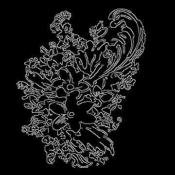
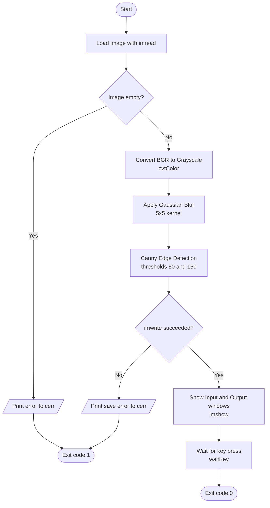
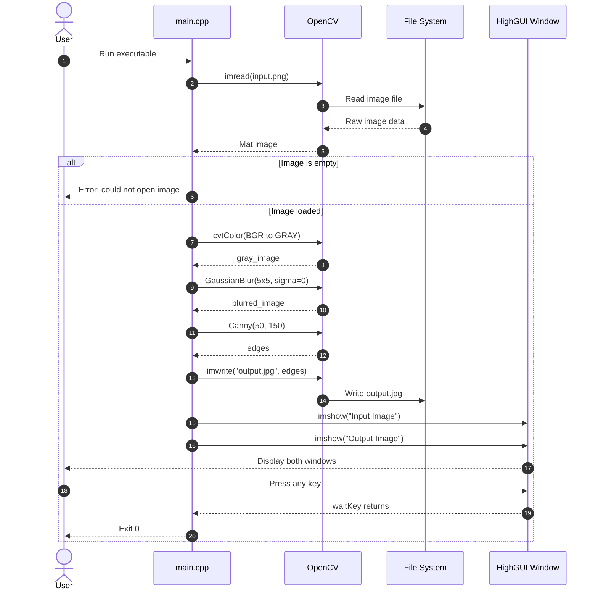
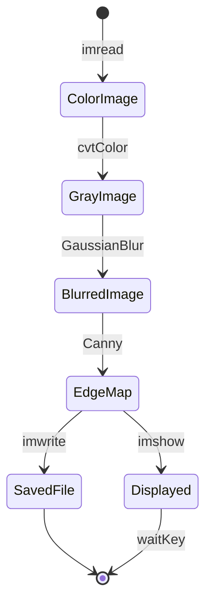
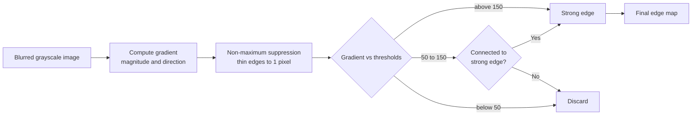
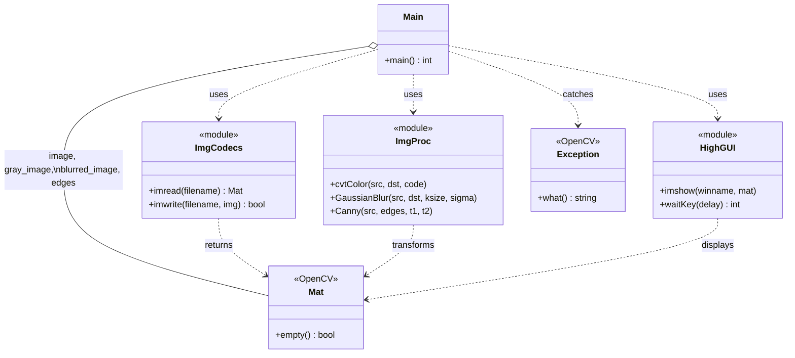

# 🖼️ Edge Detection using OpenCV (C++)

## 📖 Introduction

This project detects the edges of objects in an image using **Canny Edge Detection**, implemented in C++ with **OpenCV**. The program loads a colorful flower-border image, processes it, saves the edge map as `output.jpg`, and displays the input and output side by side.

### What is Canny Edge Detection?

**Edges** are places in an image where brightness changes sharply, such as the boundary between an object and its background. Detecting them reduces an image to its essential shapes and outlines, which is the first step in many computer-vision tasks such as object detection, image segmentation, lane detection and OCR.

The **Canny edge detector**, developed by John F. Canny in 1986, is one of the most widely used edge detection algorithms because it gives clean, thin and well-connected edges. It works in four stages:

1. **Noise reduction**: smooth the image so noise isn't mistaken for edges (Gaussian blur).
2. **Gradient calculation**: find how strongly and in which direction the brightness changes at every pixel. A large gradient means a likely edge.
3. **Non-maximum suppression**: thin the thick edge regions down to a single-pixel-wide line by keeping only the local maximum along the gradient direction.
4. **Double threshold and hysteresis**: classify pixels using two thresholds.
   - Gradient above the **high threshold (150)** is a *strong edge* and is kept.
   - Gradient below the **low threshold (50)** is discarded.
   - Pixels in between are *weak edges* and are kept only if they connect to a strong edge.

### Why do we convert to grayscale?

Edges are defined by changes in **intensity**, not by color. Converting from 3 channels (BGR) to a single grayscale channel makes the computation about three times cheaper and avoids having to merge edge results from separate color channels.

### Why do we apply Gaussian blur first?

Real images contain small random variations (sensor noise, compression artifacts, fine texture). Edge detection works by looking at differences between neighboring pixels, so it **amplifies noise**. Without blurring, the output is full of tiny false edges and speckles.

A **Gaussian blur** replaces each pixel with a weighted average of its neighbors, which smooths out noise while keeping the large, meaningful edges. In this project we use a `5×5` kernel:

- A small kernel removes noise but keeps fine detail.
- A large kernel removes more noise but can blur away real edges.

In short, **blur first, so the detector responds to real structure and not to noise.**

---

## 🎬 Demo

| Input Image | Output (Edges) |
|:-----------:|:--------------:|
|  |  |

---

## ✨ Features

- Loads an image from disk using OpenCV
- Converts the image from BGR to grayscale
- Reduces noise with a 5×5 Gaussian blur
- Detects edges with the Canny algorithm (thresholds 50 / 150)
- Saves the edge map as `output.jpg`
- Displays the input and output images in separate windows
- Error handling for a missing image, a failed save and OpenCV exceptions

---

## 📊 Diagrams

### 1. Processing Pipeline (Flowchart)



### 2. Runtime Interaction (Sequence Diagram)



### 3. Image Data Transformation (State Diagram)



### 4. Canny Algorithm Internals (Flowchart)



### 5. Component and Dependency Diagram (Class Diagram)



---

## 📁 Project Structure

```
Edge_Detection/
├── .vscode/                  # VS Code configuration
├── build/Debug/              # Build output
├── main.cpp                  # Source code
├── output.jpg                # Generated edge-detected image
└── pngtree-colorful-flowers-corner-decorative-png-clipart-image-png-image_11596999.png   # Input image
```

---

## 🚀 Build and Run

### Prerequisites

- A C++11 (or newer) compiler: GCC, Clang or MSVC
- [OpenCV](https://opencv.org/) 4.x
- (Optional) CMake 3.10+

---

## 👩‍💻 Author

**Samriddhi** ([@Samriddhi2711](https://github.com/Samriddhi2711))
